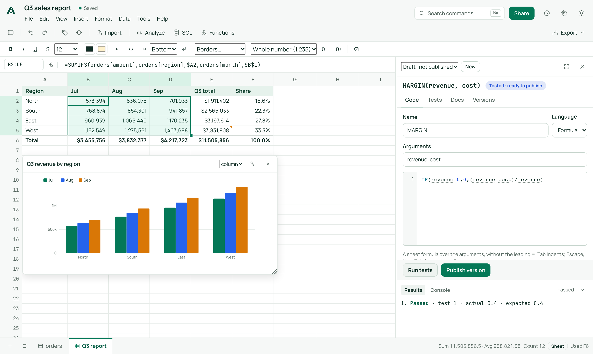

<p align="center">
  <picture>
    <source media="(prefers-color-scheme: dark)" srcset="assets/brand/alephgrid-horizontal-inverse.svg">
    
  </picture>
</p>

<p align="center">
  <strong>An open-source spreadsheet for data that doesn't fit in a spreadsheet.</strong><br>
  Tens of millions of rows, real spreadsheet formulas, SQL when you want it.<br>
  Runs on your laptop or your own server. Your data never leaves it.
</p>

<p align="center">
  <a href="https://alephgrid.dev"></a>
  <a href="LICENSE"></a>
  
  
</p>

<p align="center">
  
</p>

Open a CSV or Parquet file with tens of millions of rows, then scroll, sort, filter, edit
and add calculated columns in your browser. Next to those big tables, build ordinary sheets
with formatting, charts and Excel formulas such as `XLOOKUP` and `SUMIFS`, and point those
formulas straight at the big tables. Everything runs on a DuckDB file on your machine. There
are no seats, tiers or paywalls: export, sign-in, teams and every other feature are free.

```bash
alephgrid flights.parquet          # opens http://127.0.0.1:7878 with the file loaded
alephgrid --demo-rows 10000000     # or try it on 10M generated rows
```

| | |
|---|---|
|  |  |
| **Your own functions** in a side panel: code, tests, docs and versions | **SQL when you want it**, docked under the grid (dark theme) |
|  | |
| **The hub**: every workbook, its size and whether its compute is running | |

> **Status: pre-release.** The first release (v0.1.0) is being prepared. Today, build from
> source (or build the Docker image from a checkout); binaries, the container image, npm and
> PyPI packages are not published yet. See
> [what is shipped and what is not](docs/SPREADSHEET_FEATURES.md).

## Why Alephgrid

* **Big tables stay fast.** Opening a workbook reads nothing into memory. The grid asks only
  for the rows on screen, so scrolling to row 900,000,000 is a range read. Sorts build a
  permutation, not a copy; calculated columns are computed only for the rows you look at.
* **A real spreadsheet next to them.** Sheets use Excel syntax and an Excel-compatible engine
  ([IronCalc](https://github.com/ironcalc/IronCalc)), with formatting, merged cells, frozen
  panes, charts, colour rules, comments and XLSX import and export.
* **Spreadsheet formulas over big tables.** `=XLOOKUP(A2, customers[id], customers[region])`
  and `=SUMIFS(orders[amount], orders[region], A2)` in a sheet cell run as one query over the
  whole table, not one lookup per row. See [table formulas](docs/TABLE_FORMULAS.md).
* **No SQL required, SQL available.** Filters, pivots, joins and charts work without writing
  SQL; the SQL workspace stays closed until you open it, and a server can turn it off.
* **Yours to run.** One binary with the UI embedded, data in a plain directory, Apache-2.0.
  Teams get spaces, roles, single sign-on, audit, quotas and backups in the same binary.
* **Agents through MCP.** Give an AI agent read access to a workbook's tables, sheets and saved
  queries over the [Model Context Protocol](docs/MCP.md), with a receipt for every result.

## Features

| | |
|---|---|
| **Import** | CSV/TSV (auto-detected), Parquet, JSON/JSONL, gzip as tables; **XLSX as editable sheets**. Drag and drop or CLI. Streamed, reviewed in a side pane with column types and samples |
| **Tables** | Virtual canvas grid for any number of rows; typed edits, insert and delete rows; add, rename and delete columns; calculated columns (`=[fare_usd] / [distance_mi]`); multi-column sort and filters over the whole table; header value filters with counts; saved views |
| **Sheets** | Excel formulas, cross-sheet references, named ranges, dynamic arrays, `LET` / `LAMBDA`; formula autocomplete and argument help; undo/redo |
| **Editing** | Keyboard first: arrows, Shift and Mod selection, F2, Mod+A (the filled block, then the sheet), copy, cut, paste with formulas translated, paste special (values, formulas, formats, transpose), fill down and right, and a **fill handle** that continues series (1, 2 → 3, 4; Week 1 → Week 2) or repeats patterns. See [keyboard](docs/KEYBOARD.md) |
| **Formatting and layout** | Bold, italic, underline, strikethrough, sizes, colours, borders, alignment, wrap, number formats, merged cells; frozen rows and columns, sizes, hide and unhide (all kept through XLSX); zoom 50–200% |
| **Sheet data** | Find and replace (one sheet or all), sort and filter a range, colour rules and scales, allowed-value lists, charts (column, bar, line, area, scatter, pie) previewed before they are saved, comments with replies |
| **Analysis** | Live sum, average and count of the selection; the **Analyze** pane for summaries, pivots, joins, charts and column profiles without SQL; deduplicate, split, trim and convert types with previews |
| **SQL** | Schema browser, autocomplete, `$parameters`, cancellable previews, saved and live queries with versions, tables from queries, complete exports; reads the workbook's own tables only |
| **Functions** | Define reusable functions as sheet formulas, SQL expressions or sandboxed [Python](docs/PYTHON_FUNCTIONS.md); test them, publish versions, pin and roll back. See [functions](docs/FUNCTIONS.md) |
| **Export** | CSV, Parquet or JSON lines for any table or filtered view; XLSX for sheets, with a report of anything XLSX cannot hold |
| **Collaboration** | Several people on one workbook see each other's edits live; a change history in which table changes can be taken back |
| **Teams** | Organizations, spaces, owner/editor/viewer roles (also from identity-provider groups), invitations, service tokens, password or OpenID Connect sign-in, quotas, audit log, backups and an administration screen. See [teams](docs/TEAMS.md) |
| **Compute** | Each open workbook gets its own share of memory and threads, sleeps when idle and wakes when opened; larger sizes (`--profile`) for heavy workbooks. See [compute](docs/COMPUTE.md) |
| **Agents (MCP)** | Read-only agent connections per space or workbook over Streamable HTTP (`/mcp`) or stdio (`alephgrid mcp`): schema cards, catalog search, reads, read-only SQL, saved queries and analyses, content-hashed receipts, activity per connection. Tested with MCP Inspector and Claude Code ([tested clients](docs/MCP.md#tested-clients)) |

The full inventory, including what is partial or not planned, is in
[docs/SPREADSHEET_FEATURES.md](docs/SPREADSHEET_FEATURES.md).

## Quick start

### From source

Requires Rust 1.89+ (rustup installs the pinned toolchain from `rust-toolchain.toml`) and Node 20+.

```bash
git clone https://github.com/alephgrid/alephgrid && cd alephgrid
(cd web && npm install && npm run build)       # build the UI (embedded into the binary)
cargo build --release
./target/release/alephgrid --demo-rows 10000000
```

The first build compiles DuckDB from source, which takes several minutes.

### Install a release (not yet published)

From v0.1.0 (see [releasing](docs/RELEASING.md)); none of these work until the release exists:

```bash
npx alephgrid flights.parquet                         # npm, or: pnpm dlx / yarn dlx / bunx alephgrid
uvx alephgrid flights.parquet                         # PyPI, or: pipx install alephgrid / pip install alephgrid
docker run -p 7878:7878 -v alephgrid-data:/data ghcr.io/alephgrid/alephgrid
```

or download `alephgrid-VERSION-TARGET.tar.gz` for Linux (x86_64, arm64) or macOS (Apple
silicon, Intel) from GitHub Releases and check it against `SHA256SUMS` (not yet signed). On
Windows, use Docker or WSL. The npm and PyPI packages hold the same binary (PyPI ships wheels
only; Linux needs glibc 2.31+ and pip 20.3+).

### Docker (for a team)

From a checkout (builds the image locally):

```bash
docker compose up -d
docker compose logs alephgrid | grep "setup code"   # the one-time code that creates the admin
open http://localhost:7878/setup
```

With `--auth accounts`, people sign in with a password or single sign-on (OpenID Connect), and
spaces grant them roles; see [docs/TEAMS.md](docs/TEAMS.md). Without it (the default on your own
machine), there is no sign-in and the server only listens on 127.0.0.1. Running it for others,
backups, upgrades and restores are covered in [docs/OPERATIONS.md](docs/OPERATIONS.md).

### Options

| Flag | Env | Default |
|------|-----|---------|
| `--data-dir` | `ALEPHGRID_DATA_DIR` | `./alephgrid-data` |
| `--host` / `--port` | `ALEPHGRID_HOST` / `ALEPHGRID_PORT` | `127.0.0.1` / `7878` |
| `--auth local\|accounts` | `ALEPHGRID_AUTH` | `local`: no sign-in, loopback only |
| `--public-url` | `ALEPHGRID_PUBLIC_URL` | how people reach the server (needed for SSO; https makes cookies Secure) |
| `--oidc-issuer`, `--oidc-client-id` | `ALEPHGRID_OIDC_*` (secret: `ALEPHGRID_OIDC_CLIENT_SECRET`) | no single sign-on |
| `--session-hours` | `ALEPHGRID_SESSION_HOURS` | 12 |
| `--space-storage`, `--space-workbooks`, `--space-jobs`, `--space-open-workbooks`, `--space-compute-memory` | `ALEPHGRID_SPACE_*` | no limits (admins can set them per space) |
| `--memory-budget` | `ALEPHGRID_MEMORY_BUDGET` | 80% of RAM (or of the container's limit), shared by all open workbooks; spills to disk beyond it |
| `--threads` | `ALEPHGRID_THREADS` | all cores |
| `--disk-reserve` | `ALEPHGRID_DISK_RESERVE` | 32MiB kept back so the server can still restart when the disk fills ([operations](docs/OPERATIONS.md#disk-is-full)) |
| `--idle-timeout` | `ALEPHGRID_IDLE_TIMEOUT` | 600 seconds without activity before a workbook's compute sleeps |
| `--profile name=MEM:THREADS[:dedicated]` | | extra compute sizes admins can grant to spaces |
| `--disable-sql` | `ALEPHGRID_DISABLE_SQL` | SQL allowed; when set, every operation that runs user-written SQL is refused |
| `--demo-rows N` | | generate a demo workbook |
| `alephgrid mcp --url URL --token agc_…` | `ALEPHGRID_URL`, `ALEPHGRID_AGENT_TOKEN` | connect an MCP client over stdio to a running server ([docs/MCP.md](docs/MCP.md)) |

`alephgrid --help` lists every option.

## Formulas

**In sheets**, formulas use Excel syntax: `=SUM(B2:B9)`, `=XLOOKUP(...)`, `=Budget!B4*2`.
A sheet formula can read a whole table by name:

```
=SUMIFS(orders[amount], orders[region], $A2, orders[month], $B$1)
=XLOOKUP(A2, customers[id], customers[region], "none")
```

Fill or drag it like any formula; each copy reads its own row. The
[formula catalog](docs/FORMULA_CATALOG.md) lists supported functions with tested examples, and
[known gaps](docs/FORMULA_GAPS.md) are documented with reproducible inputs.

**In tables**, calculated columns refer to columns by name, and the leading `=` is optional:

```
=[fare_usd] / [distance_mi]
=CASE WHEN [dep_delay_min] > 15 THEN 'late' ELSE 'on time' END
=[origin] || '→' || [dest]
```

Typical flow: summarise 100M rows with Analyze or SQL, choose *Open in sheet*, then model on
top of the result.

## How it is built

* **DuckDB underneath.** Every workbook is one DuckDB file: columnar, compressed and parallel
  across cores. Imports use DuckDB's own CSV, Parquet and JSON readers.
* **IronCalc for sheets**, stored in the same workbook file.
* **Rust server** (axum, HTTP and WebSocket) with the UI embedded; **TypeScript client** with a
  canvas grid, no framework. Wire types are generated from Rust, and a test fails when they drift.

See [docs/ARCHITECTURE.md](docs/ARCHITECTURE.md).

### Measured (20M-row table, 9 columns, debug build, 8-core / 8 GB laptop)

Indicative timings from one machine, not capacity limits; none are published yet.

| Operation | Time |
|---|---|
| Reopen the workbook after a restart | 3 ms (no rehydrate) |
| Fetch 100 rows at row 0 / 10M / 19.99M | 3–11 ms |
| Filter `carrier = DL AND origin = SEA` (125k matches) | 34 ms |
| Sort 20M rows by a float column | 0.95 s |
| Sum/avg/min/max of a column over all 20M rows | 28 ms |
| GROUP BY carrier via SQL | 39–57 ms |
| Edit 1 cell / paste 1,000 cells | 3 ms / 43 ms |

Reproduce with `alephgrid --demo-rows 20000000` and `docs/bench.mjs`. The benchmark tool for
varied data shapes and concurrent clients is described in
[operations](docs/OPERATIONS.md#benchmarks); release-build results are not published yet.

## Documentation

Start at [docs/README.md](docs/README.md). The most used pages:

| For | Read |
|---|---|
| Spreadsheet users | [Features](docs/SPREADSHEET_FEATURES.md) · [Keyboard](docs/KEYBOARD.md) · [Table formulas](docs/TABLE_FORMULAS.md) · [Functions](docs/FUNCTIONS.md) · [Analysis](docs/ANALYSIS.md) |
| Running a server | [Operations](docs/OPERATIONS.md) · [Teams](docs/TEAMS.md) · [Compute](docs/COMPUTE.md) · [Security](docs/SECURITY.md) · [MCP](docs/MCP.md) |
| Contributors | [Contributing](CONTRIBUTING.md) · [Architecture](docs/ARCHITECTURE.md) · [Protocol](docs/PROTOCOL.md) · [Test strategy](docs/TEST_STRATEGY.md) |

## Development

```bash
cargo run -p alephgrid-server -- --demo-rows 1000000   # API on :7878
cd web && npm run dev                                  # UI with hot reload on :5173 (proxies to :7878)
cargo test --workspace
```

```
crates/alephgrid-core     DuckDB tables, views, formulas, IronCalc sheets (pure Rust library)
crates/alephgrid-server   axum HTTP + WebSocket server, CLI, MCP, embedded UI
web/                      TypeScript client (canvas grid, row cache, UI) and browser tests
docs/                     user, operator and contributor documentation
```

README screenshots are generated from the running product by
[`web/scripts/readme-screenshots.mjs`](web/scripts/readme-screenshots.mjs).

## Roadmap

Next after v0.1.0: S3 and Parquet data read in place, then multi-machine deployments on
Kubernetes. See [docs/ROADMAP.md](docs/ROADMAP.md) and the
[implementation checklist](docs/IMPLEMENTATION_CHECKLIST.md).

## Community

* Questions, ideas and bugs: [GitHub issues](https://github.com/alephgrid/alephgrid/issues)
  (for a bug, include steps to reproduce).
* Security problems: please report privately; see [SECURITY.md](SECURITY.md).
* Contributing: [CONTRIBUTING.md](CONTRIBUTING.md). Everyone taking part follows the
  [code of conduct](CODE_OF_CONDUCT.md).

## License

[Apache-2.0](LICENSE). Use it, host it and build on it, commercially or not.
