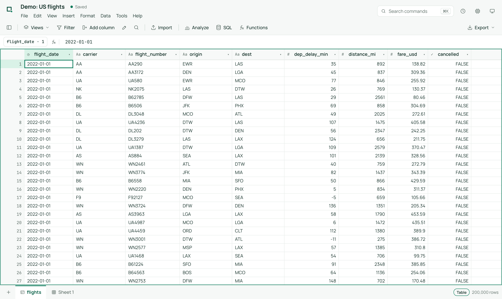
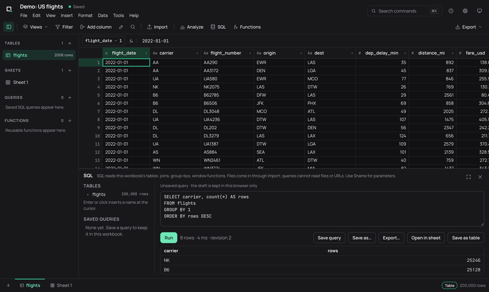
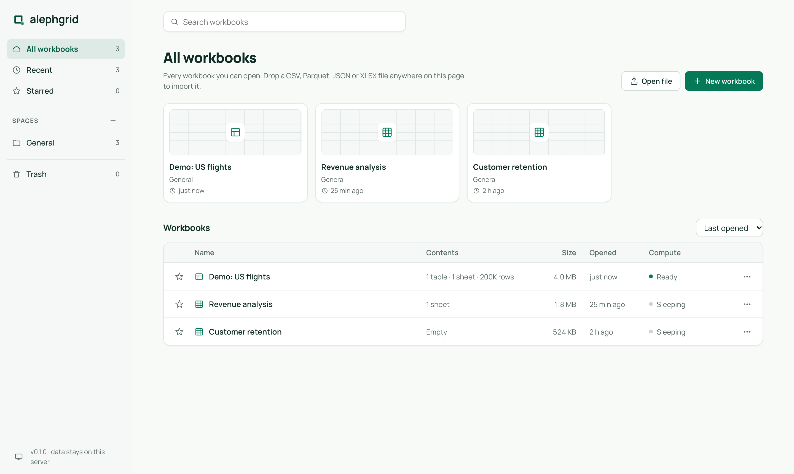

<p align="center">
  <picture>
    <source media="(prefers-color-scheme: dark)" srcset="assets/brand/alephgrid-horizontal-inverse.svg">
    
  </picture>
</p>

# Alephgrid

**An open-source spreadsheet for data that doesn't fit in a spreadsheet.**
Open CSV and Parquet files with hundreds of millions of rows, then scroll, sort,
filter, edit, add formula columns and query them with SQL, in your browser. Next to
those big tables, build ordinary Excel-style sheets with real formulas. It runs
on your laptop or your own server. Your data never leaves it, and there are no seats,
tiers or paywalls.

```bash
alephgrid flights.parquet          # opens http://127.0.0.1:7878 with the file loaded
alephgrid --demo-rows 100000000    # or try it on 100M generated rows
```

<p align="center">
  
</p>

| | |
|---|---|
|  |  |
| Dark theme, explorer and docked SQL | The hub |

Alephgrid is a self-hostable alternative to cloud big-data spreadsheets: your data
and credentials stay on your machines, workbooks open without cold starts, and
export, SSO and every other feature are free.

## Why it's fast

* **DuckDB underneath.** Every workbook is one DuckDB file: columnar, compressed,
  and parallel across all cores. Imports are DuckDB's own CSV/Parquet/JSON readers.
* **Nothing is "loaded".** Opening a workbook does not read the data into memory. The
  grid asks only for the ~40 rows on screen, and a hidden dense row id makes any
  window a zone-map-pruned range read, even at row 900,000,000.
* **Sorting materializes a permutation, not a copy.** Formula columns are lazy
  expressions, computed only for rows you look at, aggregate or export.
* **Canvas grid with block caching.** About 50 KB of TypeScript, no framework, and
  a scrollbar that keeps precision past the browser's height limit.

See [docs/ARCHITECTURE.md](docs/ARCHITECTURE.md) for details.

### Measured (20M-row table, 9 columns, debug build, 8-core / 8 GB laptop)

| Operation | Time |
|---|---|
| Generate 20M rows | 8.7 s |
| Reopen the workbook after a restart | 3 ms (no rehydrate) |
| Fetch 100 rows at row 0 / 10M / 19.99M | 3–11 ms |
| Filter `carrier = DL AND origin = SEA` (125k matches) | 34 ms |
| Sort 20M rows by a float column | 0.95 s |
| Fetch 100 rows from the sorted view | ~100 ms |
| Sum/avg/min/max of a column over all 20M rows | 28 ms |
| GROUP BY carrier via SQL | 39–57 ms |
| Edit 1 cell / paste 1,000 cells | 3 ms / 43 ms |
| Insert / delete a row mid-table | 312 ms / 173 ms |

Reproduce with `alephgrid --demo-rows 20000000` and the script in `docs/bench.mjs`.

## Features

| | |
|---|---|
| Import | CSV/TSV (auto-detected), Parquet, JSON/JSONL, gzip as tables; **XLSX as editable sheets**. Drag and drop or CLI. Streamed, no size limit |
| Grid | Virtual canvas grid, keyboard navigation, range selection, column resize and auto-fit; light, dark and system themes; menu bar, command search (⌘K), collapsible explorer |
| Edit | Typed cell edits with validation, append by typing below the last row, insert and delete rows, paste TSV from Excel or Sheets, copy ranges |
| Columns | Add, rename and delete columns; **formula columns** (`=[fare_usd] / [distance_mi]`, any DuckDB expression) |
| Views | Multi-column sort, filters (equals, contains, greater than, empty, …) applied to the whole dataset |
| Analysis | Live sum, avg, count, min and max of the selection; column summary; **SQL workspace** (schema browser, autocomplete, `$parameters`, cancellable previews, complete exports, saved and live queries with versions, refreshable query tables, INSERT/UPDATE/DELETE that keep history); SQL reads the workbook's own tables only |
| **Sheets** | Excel-style formula grids on [IronCalc](https://github.com/ironcalc/IronCalc): `=SUM`, `XLOOKUP`, cross-sheet references, undo/redo, insert/delete rows and columns with reference shifting. Stored in the same workbook file |
| Sheet formatting | Bold, italic, underline, strikethrough, font size, text and fill colours, alignment, wrap, borders, number formats (number, percent, currency, date, scientific), merged cells; all kept through XLSX |
| Sheet layout | Frozen rows and columns, row heights and column widths (drag, set, auto-fit), hide and unhide rows and columns (kept with the workbook and through XLSX); zoom 50–200% (remembered in each browser) |
| Sheet data | Find and replace (this sheet or all sheets, in values or formulas), sort a range by several columns (formulas move with their rows), range filters that hide rows, colour rules and colour scales, allowed-value lists and number ranges, charts placed on the sheet that follow the cells, comments with replies and resolve that follow their cells. Charts, colour and allowed-value rules and comments stay in the workbook: XLSX files do not get them, and the export says so |
| Tabs | Add, rename, duplicate, colour, hide and unhide, reorder by drag; references follow |
| Agents (MCP) | Read-only agent connections per space or workbook: an MCP endpoint (`/mcp`, Streamable HTTP, and stdio through `alephgrid mcp`) with schema cards, catalog search, table and sheet reads, read-only SQL, saved queries and analyses; every result pinned to a content-hashed receipt; activity per connection; see [docs/MCP.md](docs/MCP.md) |
| Bridges | SQL result → sheet, sheet → columnar table (types sniffed), all sheets → .xlsx |
| Export | CSV, Parquet or JSON lines for any table or the current filtered and sorted view; .xlsx for sheets. Free |
| Spaces | Organizations own spaces of workbooks; owner, editor and viewer roles (also for identity-provider groups), invitations, service tokens; star, recent, search, sort by size or date, rename, duplicate, move, delete |
| Collaboration | Several people on one workbook see each other's edits live |
| Hosting | One binary with the UI embedded, Docker image, password or OpenID Connect sign-in, data in a plain directory |

## Quick start

### From source

Requires Rust 1.88+ and Node 20+.

```bash
git clone https://github.com/<you>/alephgrid && cd alephgrid
(cd web && npm install && npm run build)       # build the UI (embedded into the binary)
cargo build --release
./target/release/alephgrid --demo-rows 10000000
```

The first build compiles DuckDB from source, which takes several minutes.

### Docker (for a team)

```bash
docker compose up -d
docker compose logs alephgrid | grep "setup code"   # the one-time code that creates the admin
open http://localhost:7878/setup
```

With `--auth accounts`, people sign in with a password or single sign-on (OpenID Connect), and
spaces grant them roles; see [docs/TEAMS.md](docs/TEAMS.md). Without it (the default on your own
machine), there is no sign-in and the server only listens on 127.0.0.1.

### Options

| Flag | Env | Default |
|------|-----|---------|
| `--data-dir` | `ALEPHGRID_DATA_DIR` | `./alephgrid-data` |
| `--host` / `--port` | `ALEPHGRID_HOST` / `ALEPHGRID_PORT` | `127.0.0.1` / `7878` |
| `--auth local\|accounts` | `ALEPHGRID_AUTH` | `local`: no sign-in, loopback only |
| `--public-url` | `ALEPHGRID_PUBLIC_URL` | how people reach the server (needed for SSO; https makes cookies Secure) |
| `--oidc-issuer`, `--oidc-client-id` | `ALEPHGRID_OIDC_*` (secret: `ALEPHGRID_OIDC_CLIENT_SECRET`) | no single sign-on |
| `--session-hours` | `ALEPHGRID_SESSION_HOURS` | 12 |
| `--space-storage`, `--space-workbooks`, `--space-jobs`, `--space-open-workbooks` | `ALEPHGRID_SPACE_*` | no limits (admins can set them per space) |
| `--memory-limit` | `ALEPHGRID_MEMORY_LIMIT` | DuckDB default (80% of RAM, spills to disk) |
| `--threads` | `ALEPHGRID_THREADS` | all cores |
| `--disable-sql` | `ALEPHGRID_DISABLE_SQL` | SQL allowed; when set, every operation that runs user-written SQL is refused (console, saved queries, tables from queries, SQL formula columns, SQL functions) |
| `--demo-rows N` | | generate a demo workbook |
| `alephgrid mcp --url URL --token agc_…` | `ALEPHGRID_URL`, `ALEPHGRID_AGENT_TOKEN` | connect an MCP client over stdio to a running server ([docs/MCP.md](docs/MCP.md)) |

## Formulas

Formula columns use DuckDB's SQL expression language. `[Column Name]` refers to a
column, and the leading `=` is optional:

```
=[fare_usd] / [distance_mi]
=CASE WHEN [dep_delay_min] > 15 THEN 'late' ELSE 'on time' END
=strftime([flight_date], '%Y-%m')
=[origin] || '→' || [dest]
```

Formula columns can be sorted and filtered on, and can reference earlier formula
columns.

For free-form work, add a **sheet** (the `+` button next to the tabs). Sheets use
Excel syntax (`=SUM(B2:B9)`, `=XLOOKUP(...)`, `=Budget!B4*2`) and are evaluated by
IronCalc. Typical flow: aggregate 100M rows with SQL, choose *Open in sheet*, then
model on top of the result.

### User-defined functions

Choose **Formula help** to search built-in availability, signatures and tested examples. The formula bar
suggests 44 reviewed sheet functions, including `XLOOKUP`, `VLOOKUP` and `SUMIFS`.
See the [catalog scope](docs/FORMULA_CATALOG.md): registry recognition is distinct from full compatibility,
and spreadsheet-style formulas over DuckDB tables remain planned.
Formula help also shows mode-level evidence: 115 passing cases and six explicitly documented
[compatibility gaps](docs/FORMULA_GAPS.md), with reproducible inputs and expected results.

Choose **Functions** in a workbook to define and test reusable sheet formulas or SQL scalar
expressions. Call `=MARGIN(B2,C2)` in a sheet, or a SQL function in queries and calculated columns.
Definitions have immutable versions, explicit upgrade/rollback and pinned dependencies.
See [the function guide](docs/FUNCTIONS.md) for examples, supported expressions and XLSX limitations.

### No-code analysis

Use **Analyze** to build and save summaries, pivots, charts, joins and column profiles without
writing SQL. **Find / replace** previews text changes and offers guarded undo; **Format table**
saves number/date formats, hidden/frozen columns and conditional rules. Results remain bounded
and calculations run on the server. See [the analysis guide](docs/ANALYSIS.md) for workflows and limits.

## Development

```bash
cargo run -p alephgrid-server -- --demo-rows 1000000   # API on :7878
cd web && npm run dev                                  # UI with hot reload on :5173 (proxies to :7878)
cargo test --workspace
```

Layout:

```
crates/alephgrid-core   DuckDB tables, views, formula columns, IronCalc sheets (pure Rust library)
crates/alephgrid-server   axum HTTP + WebSocket server, CLI, embedded UI
web/                      TypeScript client (canvas grid, row cache, UI)
docs/                     architecture, protocol, roadmap
```

## Roadmap

See [docs/ROADMAP.md](docs/ROADMAP.md) and [docs/IMPLEMENTATION_CHECKLIST.md](docs/IMPLEMENTATION_CHECKLIST.md).
Highlights: quotas, audit and shared saved objects for teams, Postgres, Snowflake, BigQuery and
S3 connectors (DuckDB extensions), a desktop app (Tauri) and a pure in-browser mode (DuckDB-WASM).

## License

[Apache-2.0](LICENSE). Use it, host it and build on it, commercially or not.
