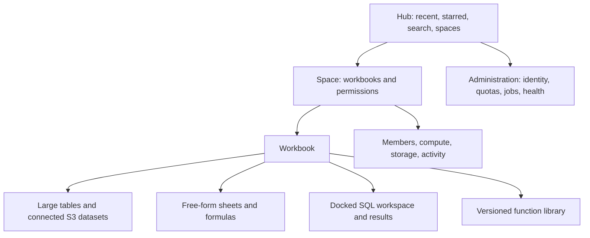
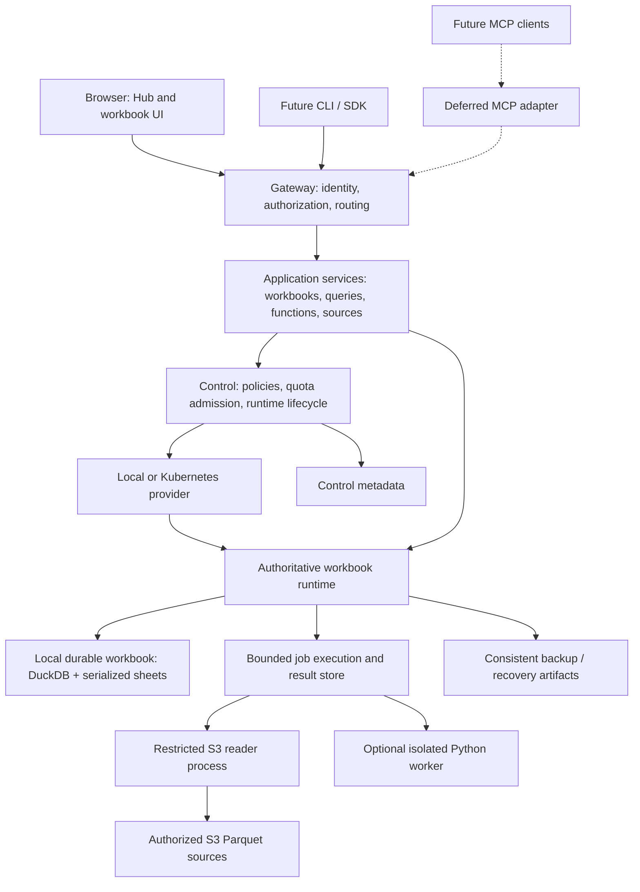
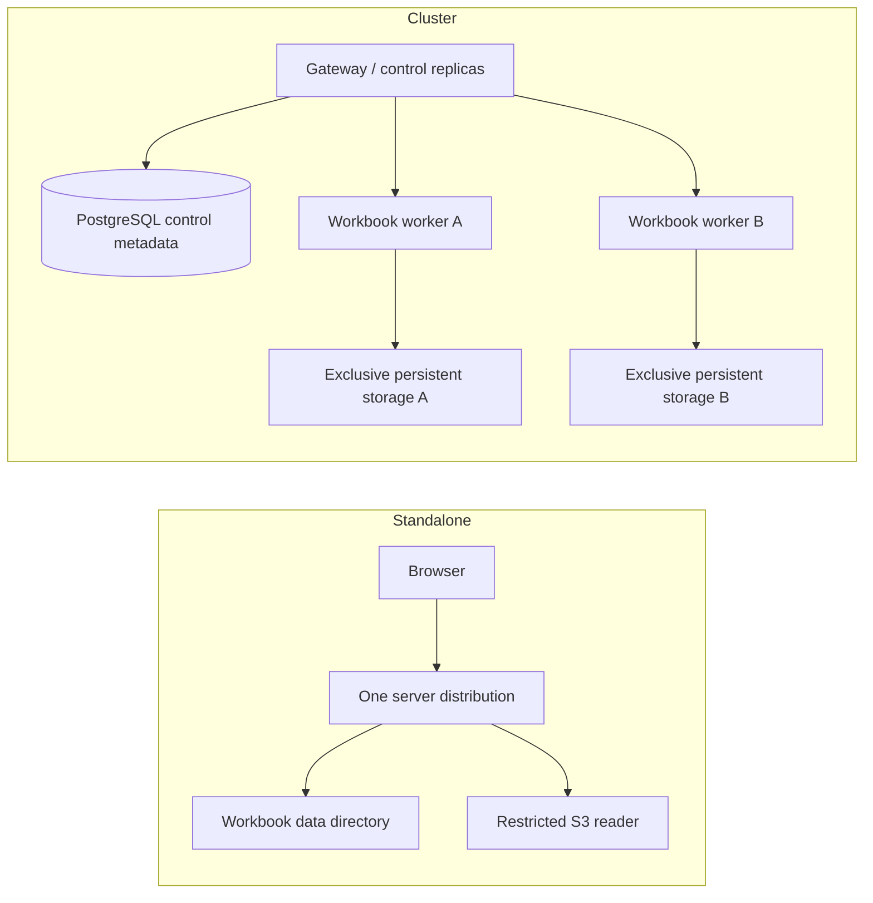

# Alephgrid — high-level design

Date: 27 October 2026. Status: target architecture / planning, not implementation certification.

Read this first, then [LLD](LLD.md) for contracts and execution flows. [Implementation checklist](IMPLEMENTATION_CHECKLIST.md) remains the completion tracker; [current architecture](ARCHITECTURE.md) describes the existing system.

## 1. The finished product

Alephgrid is a self-hostable analytical workspace: users explore large tables with DuckDB, build free-form spreadsheet models with IronCalc, save SQL analyses, and reuse versioned functions. An organization owns its spaces and durable workbooks. Opening a workbook automatically starts or locates approved compute.

The same experience runs on one machine or on a cluster. A cluster distributes workbooks across workers; it does not automatically distribute one SQL query across machines. Future agents access the same services through MCP, leaving analyses users can inspect in the UI.

### What a user sees

Light, dark and system themes share layouts. The grid is the main surface; explorer and SQL panels collapse. Tables, sheets, queries and functions have distinct icons and behavior. Saving, stale results, cancellation, reconnects and errors are explicit states. A sleeping workbook is normal, not a failure.

| Surface | Main workflow | Dependency |
|---|---|---|
| Hub | Open/create/import/find workbooks | Local product, then team permissions |
| Workbook | Browse/filter/sort/edit local data | Existing core plus UI refinement |
| SQL | Query → inspect → save → create table/sheet | SQL phase and remote-source restrictions |
| Functions | Define → test → publish → pin version | Formula/SQL functions; isolated Python later |
| Connections | Register S3 dataset → preview → query/snapshot | S3 first |
| Sharing/history | Grant access, inspect changes, recover | Identity/revisions/audit |
| Compute settings | Choose authorized profile, controlled restart | Runtime policy/provider |
| Agent connections | Connect agent, scope access, inspect activity | Deferred MCP |

## 2. Delivery boundaries

| Stage | Included | Excluded from its promise |
|---|---|---|
| Current foundation | Rust server, DuckDB tables, IronCalc sheets, SQL, bounded jobs and revisions documented in ARCHITECTURE | This document does not re-certify checked tasks |
| S3-first connected release | Scoped read-only Parquet, bounded results, snapshot import, refresh, diagnostics | MCP, GCS, Azure, Postgres, remote write-back |
| Complete team product | Identity, spaces, quotas, collaboration, functions, full UI, restore/upgrade | Python only after isolation gates |
| Kubernetes beta | Policy-managed placement and exclusive workbook ownership | Automatic lossless failover across every failure domain |
| Later extensions | MCP, additional connectors, lakehouse catalogs, stronger recovery | Each requires its own acceptance decision |

UI work follows the underlying feature releases. A concept screen never establishes implementation status.

## 3. System architecture

These boxes describe responsibilities, not mandatory microservices. Standalone packaging keeps most responsibilities in one Rust server; network-enabled data reading and untrusted Python have separate execution boundaries. The Kubernetes deployment separates routing/control from workbook workers where needed.

## 4. Component responsibilities

| Component | Owns | Does not own |
|---|---|---|
| Browser | Presentation, bounded cache, drafts, keyboard interaction | Durable truth or permission decisions |
| Application services | Permission checks, typed commands, revisions, jobs, audit | Arbitrary direct file mutations |
| Control services | Runtime placement, policies, quota reservations, readiness | Spreadsheet calculation |
| Workbook owner | Authoritative mutations, DuckDB/IronCalc state, commit/history | Independent writers to the same file |
| S3 reader | Authorized remote reads, query work, bounded artifacts | Workbook mutation or unrestricted host access |
| Function worker | Versioned bounded calculations | Credentials, workbook files, implicit publication |
| Result store | Paged query artifacts with TTL and authorization | Permanent data unless materialized |
| Runtime provider | Start/status/drain/stop and reconciliation | User permissions or durability policy |

## 5. Important storage distinctions

1. **User source storage:** S3 Parquet remains owned by the source organization. First release is read-only.
2. **Workbook storage:** local tables, sheet state, query definitions, function pins, revisions and provenance. The active DuckDB file stays on suitable worker storage.
3. **Control metadata:** identity, memberships, policies, runtime allocations and routing. Standalone must not require PostgreSQL; cluster mode uses PostgreSQL-backed control metadata.
4. **Temporary/cache storage:** query results, uploads, downloads, remote cache and spill; bounded and reclaimable under lifecycle rules.
5. **Backup storage:** consistent checkpoints and later recovery artifacts. This is separate from S3 datasets, even when an administrator chooses the same cloud provider.

Live datasets reflect source state under a documented read contract. Imported snapshots are local copies. Cached results retain their source identity and freshness; caches never silently masquerade as current data.

## 6. Standalone and cluster deployment

No instance chooser is required before opening a workbook. Profiles are administrator-approved options. Idle shutdown retains durable data. Resize initially drains and restarts compute; it is not live migration.

One mutable workbook has one owner. Lease expiry alone cannot prevent a still-running process from writing a DuckDB file. Replacement requires proven old-owner termination and exclusive storage handoff. When uncertain, block writes and surface recovery instructions.

## 7. Performance strategy

Optimize the amount of work before increasing capacity: select necessary columns, prune partitions/row groups, avoid automatic full counts, reuse query results for scrolling and locate compute near storage. Measure cold/warm behavior, request count, bytes, memory/spill, first usable result and concurrent-client latency.

Start with DuckDB's existing storage capabilities. Evaluate extra caching only after baselines. Community cache_httpfs is a candidate, not a selected dependency. Iceberg and multi-node execution of one query remain later decisions. File-layout health reports explain expensive datasets without rewriting sources automatically.

## 8. Trust and extensibility

Permissions apply across HTTP, WebSocket, SQL, result pages, exports, connectors and future MCP. An opaque ID is not authorization. User SQL never receives storage credentials or permission to load extensions. Python runs under an independently tested isolation policy.

Internal contracts are DataConnector, RuntimeProvider, FunctionRuntime and artifact storage. Publish stable external contracts only after real implementations and conformance suites prove them. MCP is a future adapter to the same services, not a second execution engine.

## 9. Acceptance and unresolved choices

Completion means exact analytical results, bounded execution, recoverable failure, accessible journeys, cross-space isolation and install/restore/upgrade evidence. See checklist sections U, 10, P, 7–11 and deferred M.

Before S3 implementation, prototype the isolated reader boundary, permitted SQL binding, result artifact format, source version verification and mixed local/remote query strategy. Before cluster release, prove storage handoff and define recovery objectives. Before Python release, select and attack-test the isolation mechanism. None of these is solved merely by drawing this architecture.
