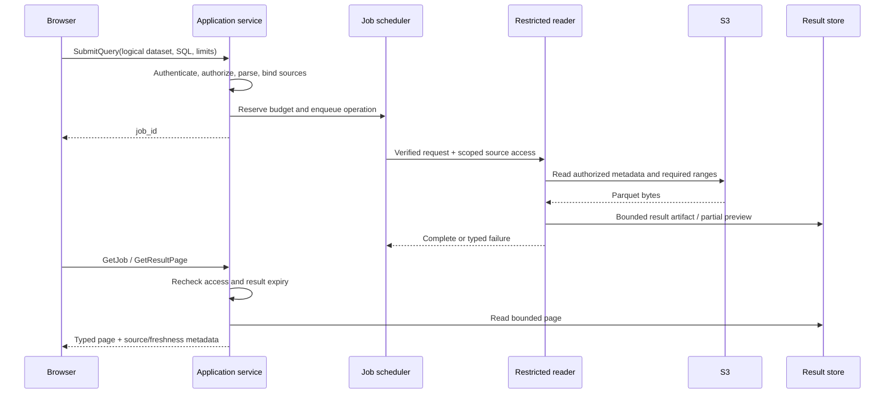
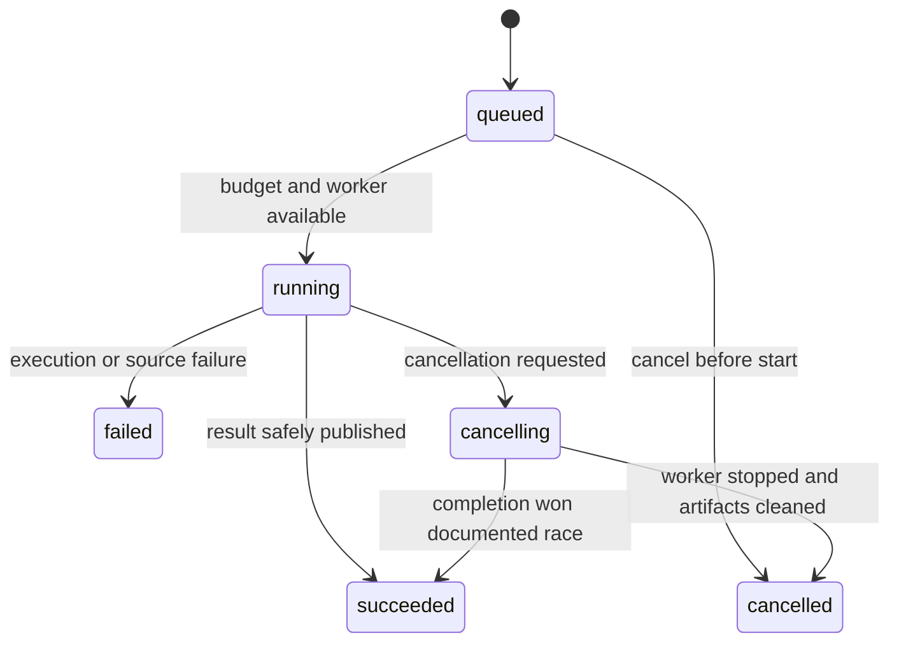

# Alephgrid — low-level design

Date: 27 October 2026. Status: proposed contracts and algorithms; not code or a frozen API.

Read [HLD](HLD.md) for the product/deployment view. Existing implementation details remain in [ARCHITECTURE](ARCHITECTURE.md); progress belongs in [IMPLEMENTATION_CHECKLIST](IMPLEMENTATION_CHECKLIST.md). All names and routes below are proposals unless explicitly identified as existing.

## 1. Existing seams and proposed responsibilities

| Existing location | Current responsibility | Proposed extension |
|---|---|---|
| `web/src/` | Canvas grid, cache, UI, RPC | Shared themes, Hub/explorer, docked panels, connection workflows |
| `alephgrid-server/src/http.rs`, `ws.rs`, `protocol.rs` | Transport and typed operations | Thin adapters to authorized application commands |
| `alephgrid-server/src/sched.rs` | Bounded jobs | Source-reader jobs and result lifecycle |
| `alephgrid-server/src/runtime/` | Local lifecycle/budget/provider contracts | Policy-backed cluster placement later |
| `alephgrid-core/src/workbook.rs`, `storage.rs` | Workbook state, revisions, transactions | Connector references and atomic snapshot imports |
| `alephgrid-core/src/sqlpolicy.rs` | SQL validation and capability restrictions | Logical registered dataset binding, never unrestricted external readers |
| `alephgrid-core/src/queries.rs` | Saved queries and materialization | Source identities and reusable remote result handles |
| `alephgrid-core/src/sheets.rs` | IronCalc state | Function pins/integration under existing commit rules |

Do not split crates just to match the diagram. Extract a module/process when its lifecycle or trust boundary requires it.

## 2. Critical S3 boundary

The current server opens workbook DuckDB with `enable_external_access = false`, constrained directories and extension auto-loading disabled. That setting cannot simply be toggled on inside an existing open workbook. Relaxing it globally would undermine phase 4 security.

**Proposed decision:** a separate restricted S3 reader process owns a network-enabled DuckDB instance. It receives only authorized dataset descriptors, short-lived/scoped credential material where supported, verified query plans and budgets. It has no writable workbook file access. Extensions are pinned and provisioned by the distribution, not installed by user SQL.

The reader process must also have OS/container restrictions and controlled egress; a subprocess alone is not a complete security boundary. A malicious SQL function or arbitrary endpoint must not gain host filesystem or metadata-service access. Prototype the restrictions on every supported platform; explicitly limit deployment trust if they cannot be enforced.

First implementation supports queries over registered remote datasets and local materialized snapshots. Mixed local/remote joins either stage bounded local inputs through a controlled artifact channel or require an explicit snapshot first. Do not promise transparent federation until transfer, consistency and limits are proven. Display the required step in the UI rather than silently downloading the whole lake.

## 3. Proposed domain records

| Record | Minimum fields and constraints |
|---|---|
| Space | `id`, organization, membership policy, quota/policy references |
| Workbook | `id`, `space_id`, revision, storage format, runtime spec, lifecycle state |
| Connection | `id`, `space_id`, kind=S3, region, permitted bucket/prefixes, `credential_ref`, authorization generation |
| Dataset | `id`, connection, logical name, schema/version, file-selection rule, partition schema, source mode |
| SourceRead | `id`, dataset, observed file identities, consistency mode, start time, verified snapshot identity if available |
| QueryJob | `id`, principal, workbook, operation/idempotency key, query hash, typed parameters, source read, budgets, state, cancel flag |
| QueryResult | `id`, job, schema, artifact reference, complete/truncated flags, row count if known, source identity, expiry |
| SavedQueryVersion | query ID/version, SQL, parameter schema, creator, timestamp |
| Materialization | destination table, saved-query version, source identities, output schema, refresh status, last success |
| FunctionVersion | immutable ID/version, signature, source/hash, adapter/runtime identity, tests, purity declaration |
| RuntimeAllocation | allocation ID, spec, provider, owner/workbook assignment, lifecycle operation, readiness |

Credential values live in a secret backend, not workbook metadata. IDs returned by a client are resolved and authorized server-side. Result grants cannot exceed the underlying dataset/workbook permissions.

Existing local records use `_rf_id` and `_rf_ord`; do not fabricate equivalent stable remote identities from incidental file scan order. Rows in an immutable result artifact can have result-local positions, valid only for that result ID.

## 4. Commands and error contract

Proposed logical commands (HTTP and WebSocket may expose equivalent operations):

| Command | Inputs | Output |
|---|---|---|
| CreateConnection / TestConnection | S3 config + credential reference | authorized connection + health/error |
| RegisterDataset / DescribeDataset | connection ID, prefix selection | dataset ID, typed schema, partitions |
| SubmitQuery | workbook, SQL, typed parameters, limits, operation ID | job ID |
| GetJob / CancelJob | job ID | state/progress/cancellation acknowledgement |
| GetResultPage | result ID, cursor, selected columns, byte/row limit | typed rows, next cursor, truncation |
| ImportSnapshot | dataset/result ID, target name, expected revision, mutation ID | job then committed table/revision |
| RefreshMaterialization | table ID, expected revision, mutation ID | job then atomic new revision |

All responses carry a request ID. Errors use stable codes such as `permission_denied`, `source_changed`, `schema_changed`, `credential_expired`, `quota_exceeded`, `result_expired`, `revision_conflict`, `cancelled`, `unsupported_capability` and `internal_error`; include retryability and safe recovery instructions, not secrets or raw internal paths.

Validate sizes before allocation. Typed wire values preserve decimal and large-integer precision; NULL is distinct from an empty string. Parameter values never become SQL text. Identifiers are resolved/quoted separately. Cross-layer schema generation or contract tests remain mandatory.

## 5. S3 query flow

A preview may be ready before the complete artifact, but it must be labeled partial. A row limit caps output, not necessarily scan work: sorting/aggregation may still require large scans. Enforce time, memory, spill and concurrency independently; meter remote bytes where feasible and document enforcement granularity.

Never rerun a whole source query for each scroll. A published immutable result supports bounded cursor paging. Cursors bind result ID, position/projection and authorization context and are validated server-side. Expired results prompt rerun; pages from different results cannot be mixed.

## 6. Jobs and cancellation

Persist enough job state for reconciliation. A cancellation acknowledgement means intent received; it does not claim the worker has stopped. Publish a terminal outcome atomically and prevent late results from overwriting it. Killing a stuck isolated reader must not terminate unrelated workbook work. Reserve/release budgets exactly once through idempotent reconciliation.

Queued work may be resumed after restart according to policy; do not automatically replay committed mutations. A failed live query retains the user's SQL draft. Result TTL, per-space storage and cleanup are bounded; never delete an artifact still leased by an active page/export consumer.

## 7. Snapshot import and refresh commit

1. Authorize source and destination; record expected workbook revision and source read contract.
2. Execute remote work outside the mutable workbook critical section into a bounded staged artifact.
3. Validate schema/types, completeness and source consistency; abort on mismatch under strict mode.
4. Reauthorize and acquire the owner mutation boundary. Recheck destination revision and dependencies.
5. In one transaction, import/replace rows, allocate local IDs, update lineage, increment revision and record mutation ID/history.
6. Acknowledge only after the documented durable commit boundary; publish change events after commit.
7. Clean staging artifacts. A retry of the same committed mutation returns its prior result.

Failed refresh keeps the last successful materialization and marks refresh failure separately. Existing user edits must trigger the documented conflict/replace policy; never erase them silently. Current query refresh semantics may allocate new record IDs; clients must resync rather than reuse old row selections.

Raw S3 listing is not a multi-file transaction. Initial product can prefer immutable datasets; source changes under strict reads cause a restart/error. Snapshot import creates a stable output, but cannot retroactively guarantee its inputs represented one source transaction. State this limitation in lineage.

## 8. Cache design

| Layer | Key / validity | Boundaries |
|---|---|---|
| Browser pages | result/view ID, revision, columns, block | Byte limit; invalidate on revision/result replacement |
| Remote metadata/data | connection authorization scope, object identity/version, byte range | Revalidate changes, bounded memory/disk; credential revocation enforced |
| Query result | normalized verified query, exact typed parameters, source snapshot, engine/function versions, access scope | Eligible deterministic queries only; explicit TTL |
| Materialized table | saved-query version + source lineage | Durable user-visible artifact; explicit refresh |

Do not key only by SQL or object URL. Do not call an ETag a content hash or assume it establishes a cross-file snapshot. Prefer tenant-local caches initially. Cross-user reuse requires proof of equivalent authorization and source semantics. Coalesced consumers have independent access/cancellation; one user's cancellation must not abort another's valid request without a defined policy.

Evaluate DuckDB built-in cache before cache_httpfs. The community extension remains optional pending license/provenance, exact-version compatibility, validation and failure tests. Do not add a separate distributed cache service without measured need.

## 9. Function execution

Formula-defined/SQL functions use supported engine integration and immutable registry versions. Python runs through the `FunctionRuntime` adapter in sandboxed workers (phase 8, docs/PYTHON_FUNCTIONS.md) with no inherited credentials, bounded batch inputs/outputs and network disabled by default.

Capture input and function revisions → execute outside workbook lock → validate typed output → recheck revisions/permissions → commit or report stale result. Pure-function caching includes exact inputs and function/runtime versions. Volatile or side-effecting code cannot participate in automatic pure recalculation. Tests and publication permissions are separate from ordinary execution.

## 10. Runtime ownership and collaboration

Open workbook → authorize → reserve approved capacity → find owner or idempotently ensure allocation → wait for readiness → route all collaborators to owner. Reconnect carries last observed revision; missing events trigger resync.

A control-plane ownership epoch helps reject stale requests, but does not fence an old process writing an open file. Kubernetes replacement must separately prove exclusive storage ownership. If control metadata and workbook state disagree, reconcile conservatively and refuse conflicting writers. Control metadata updates and DuckDB mutations are not one distributed transaction; use operation IDs, reconciliation and durable commit records rather than pretending atomicity across both databases.

Resize: stop admission → drain/cancel by policy → persist/checkpoint → close old owner → verify handoff → start pinned runtime → route/resync. Preserve workbook URL and function versions. Define phase-specific durability/restore limits before stronger failover promises.

## 11. UI state contracts

Hub uses lightweight metadata, not opening every workbook database for a list. Workbook panels reference stable object IDs. Unsaved editor drafts remain distinct from saved query versions. “Saved” reflects an acknowledged revision. SQL scope identifies registered datasets; grid filters do not implicitly rewrite queries.

Connection screens show source, access mode and freshness. Compute screens show queued/starting/ready/draining/failed; sleeping is neutral. Theme tokens include selection, error, disabled and chart states with accessible contrast; canvas colors and DOM controls share the same theme source. Narrow windows collapse panels rather than shrink cells beyond usability.

## 12. Future MCP adapter (deferred)

MCP tools call the commands in section 4 with the same principal, source scopes and quotas. Tools return compact typed results and references, not entire datasets. Resources expose metadata/documentation; job tools work without optional Tasks support. Writes add operation IDs, expected revisions and configured approval enforcement. Agent activity appears in ordinary history. External model data transmission must be explained in connection setup. Verify selected clients and protocol versions at implementation time.

## 13. Verification map and implementation decisions

| Invariant | Required evidence | Checklist |
|---|---|---|
| S3 cannot bypass workbook restrictions | Adversarial SQL/file/network tests through actual reader boundary | 10.10, 10.T02 |
| Scroll does not rescan whole source | Instrumented page sequence, request/byte counts | 10.13, P.06 |
| Snapshot/refresh is atomic | Faults before/during/after commit; independent value comparison | 10.15, 10.T03 |
| Cache never crosses permission boundary | Revocation, tenant key collisions, stale-source tests | P.T02 |
| Execution remains bounded | Queue/load, memory/spill, cancellation/kill tests | P.T01–P.T02 |
| No concurrent workbook writers | Live old owner during partition; exclusive handoff evidence | 11.T02 |
| UI describes actual state | Browser journeys and persisted-state assertions | U.T01–U.T02 |
| Agent behavior shares constraints | Client contract and end-to-end analytical evaluations | M.T01–M.T02, deferred |

Prototype decisions before implementation: reader isolation/egress enforcement; result artifact format (bounded typed pages, possible Arrow IPC/Parquet after measurement); source version-read support; mixed-source query staging; actual memory/disk/time budgets; standalone secret backend; cluster storage handoff and Python isolation. Record decisions and evidence in the tracker. No performance numbers or availability objectives are guaranteed by this design.
